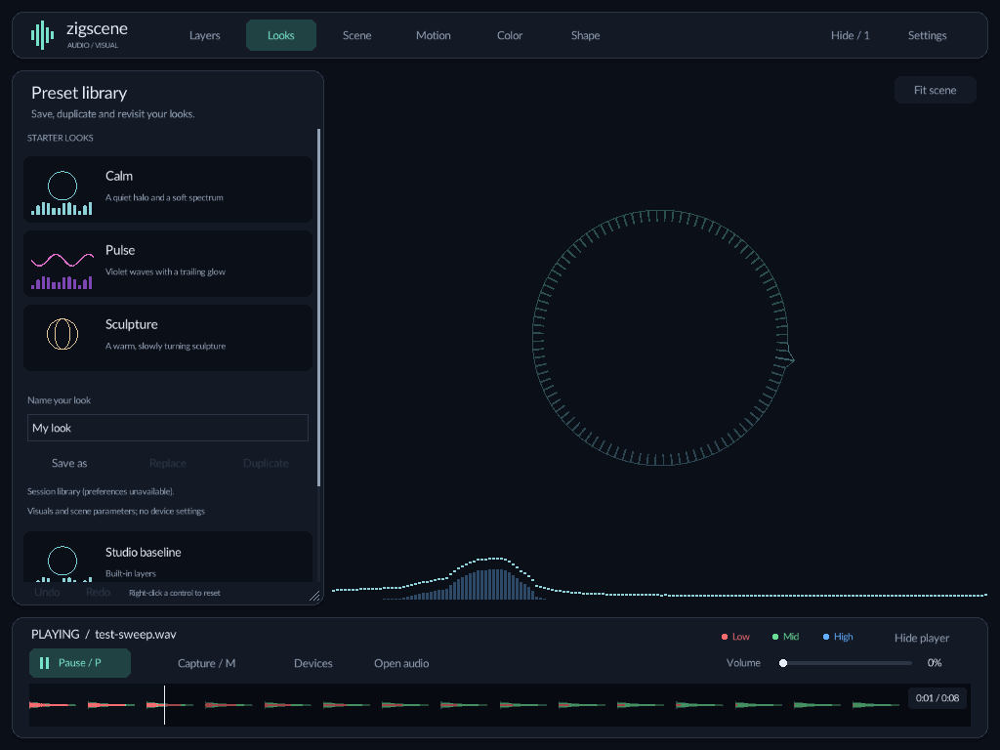
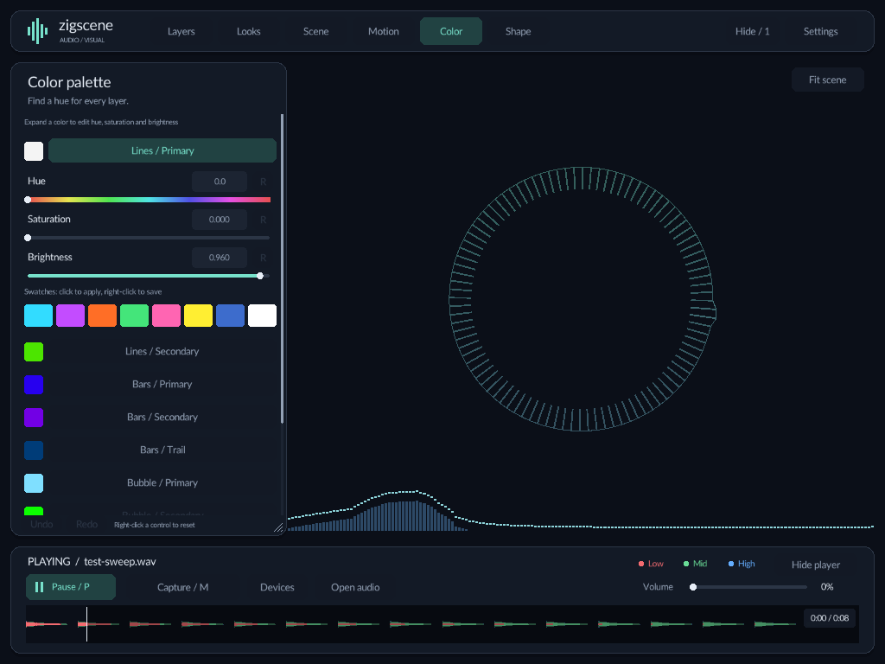
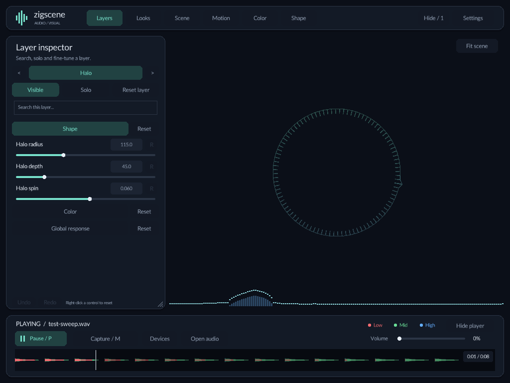
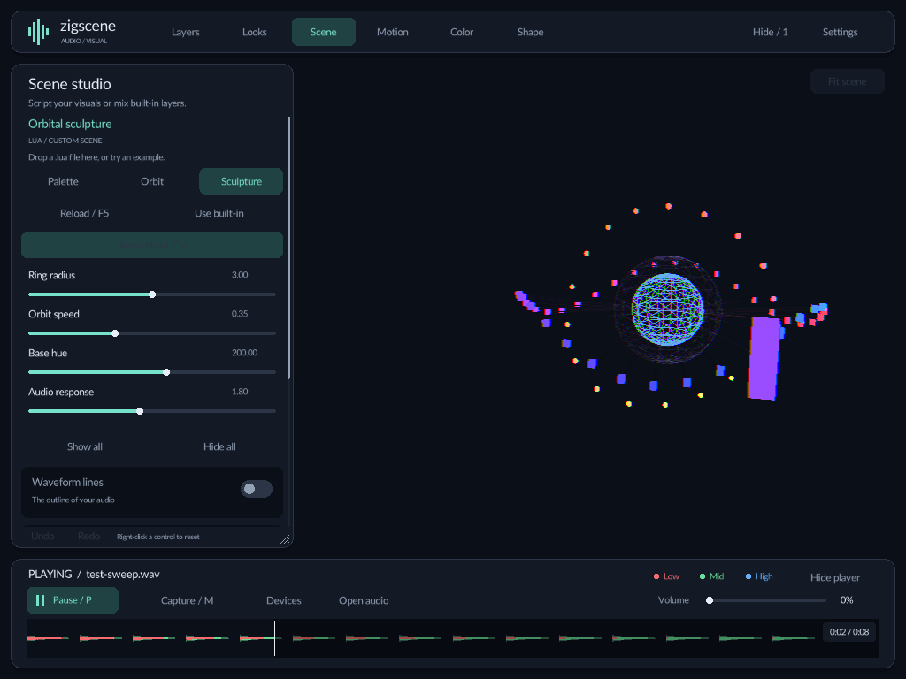
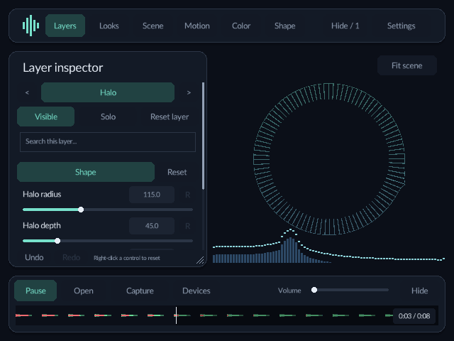

# zigscene

An audio visualizer built with Zig and raylib. Play an audio file or capture live
audio, customize the built-in layers, or write a Lua scene.

**Zig 0.16.0** · [Releases](https://github.com/ngynkvn/zigscene/releases) ·
[Documentation](docs/README.md)

## Getting started

1. [Download a release](#download-a-release) or [build from source](#build-from-source).
2. Choose **Open audio** or **Capture system audio**. You can also
   drop an MP3, WAV, or OGG onto the window.
3. Choose **Calm**, **Pulse**, or **Sculpture** in **Looks / 7**, then tune a layer
   in **Layers / 8**. **Scene / 5** has programmable Lua examples.
4. Choose **Save as** to keep a look. **Undo / Redo** includes switching looks.

The editor adapts to small windows, keeps the scene clear of the controls, and
includes keyboard focus, visible resets, and full HSV colors with saved swatches.
See [visual editing](docs/usage.md#explore-and-save-a-look).

For live audio, click **Devices** in the player, choose a source, then click
**Capture / M**. See the [capture guide](docs/usage.md#capture-live-audio) for
platform-specific setup.

### Download a release

Choose an archive from [Releases](https://github.com/ngynkvn/zigscene/releases):

| Platform | Archive | After extraction |
| --- | --- | --- |
| macOS, Apple Silicon | `zigscene-macos-aarch64.tar.gz` | Run `./zigscene-macos-aarch64` |
| Linux, x86_64 | `zigscene-linux-x86_64.tar.gz` | Run `./zigscene-linux-x86_64` |
| Windows, x86_64 | `zigscene-windows-x86_64.zip` | Open the extracted folder and run `zigscene.exe` |

The macOS and Linux archives preserve executable permissions. For example:

```sh
tar -xzf zigscene-macos-aarch64.tar.gz
./zigscene-macos-aarch64
```

If macOS blocks a trusted download, see
[macOS quarantine](docs/usage.md#macos-blocks-the-downloaded-app).

### Build from source

With Zig `0.16.0` on your `PATH`, run these commands from the repository root:

```sh
zig build run

# Or start with a track
zig build run -- song.wav
```

See the [development guide](docs/development.md) for cloning, Linux dependencies,
optimized builds, tests, and release builds.

### Web build

The browser target supports **Open audio** and dropped files.
Lua scenes, live capture, and native window controls are unavailable there;
browser preferences are not saved.
See [building for the web](docs/development.md#web-build) for Emscripten commands
and output files.

## Usage

| Task | Where to go |
| --- | --- |
| Play a track, seek, or understand waveform colors | [Playback](docs/usage.md#play-a-track) |
| Capture system audio or choose an input | [Live capture](docs/usage.md#capture-live-audio) |
| Run a small Windows desktop overlay | [Desktop pet](docs/desktop-pet.md) |
| Find a key or mouse control | [Shortcuts](docs/usage.md#shortcuts) |
| Change layers, layout, opacity, or FPS | [Customize the scene](docs/usage.md#customize-the-scene) |
| Find or reset saved preferences | [Saved settings](docs/usage.md#saved-settings) |
| Resolve loading, capture, or script problems | [Troubleshooting](docs/usage.md#troubleshooting) |

Native settings persist between runs, including volume, colors, panel sizes,
UI scale, and window preferences. Lua overrides are restored before settings are
saved. Capture-device selection and script parameter sliders last for the session.

## Programmable scenes

Open **Scene / 5** and choose **Palette** (built-in layers), **Orbit** (2D), or
**Sculpture** (3D). Each example has an **Audio response** slider and editable
[source](src/scripting/examples).

Drop a `.lua` file to load your own scene, or launch with one:

```sh
zig build run -- --scene=src/scripting/examples/orbit.lua song.wav
```

Lua is embedded; no separate installation is needed. Files reload when saved,
and **F5** reloads manually. Start with the
[Lua scene guide](docs/scripting.md#script-structure), then use its
[API and settings reference](docs/scripting.md#host-interface).

## Documentation

[Browse all documentation](docs/README.md), or go directly to:

- [User guide](docs/usage.md): playback, capture, controls, and preferences.
- [Lua scenes](docs/scripting.md): examples, callbacks, drawing, and settings.
- [Development](docs/development.md): builds, tests, and diagnostics.
- [Architecture](ARCHITECTURE.md): frame flow, module ownership, audio, and Lua.
- [Audio experiment](docs/audio-experiment.md): historical measurements and limits.

## Screenshots

The native workspace includes starter looks, full HSV color editing, a searchable
layer inspector, and live Lua scene parameters. Click an image for a closer look.

| Starter looks | HSV color editor |
| --- | --- |
| [](docs/assets/studio.png) | [](docs/assets/color-editor.png) |

| Layer inspector | Lua scene studio |
| --- | --- |
| [](docs/assets/layer-inspector.png) | [](docs/assets/lua-sculpture.png) |

[](docs/assets/compact-editor.png)

<details>
<summary>More visualizations</summary>

<div style="display: flex; flex-wrap: wrap; gap: 10px;">
    
    
    
    
</div>

</details>

## Licenses

### UI font

The interface embeds Lato Regular by the Lato Project Authors under the
SIL Open Font License
([font license](src/gui/assets/OFL.txt)).

### Lua license

Lua 5.4.9 is embedded under the MIT license
([Lua copyright and license](docs/licenses/Lua.txt)).

### Audio chooser

Native file selection uses tinyfiledialogs under the Zlib license
([source and license](deps/tinyfiledialogs/SOURCE.txt)).
